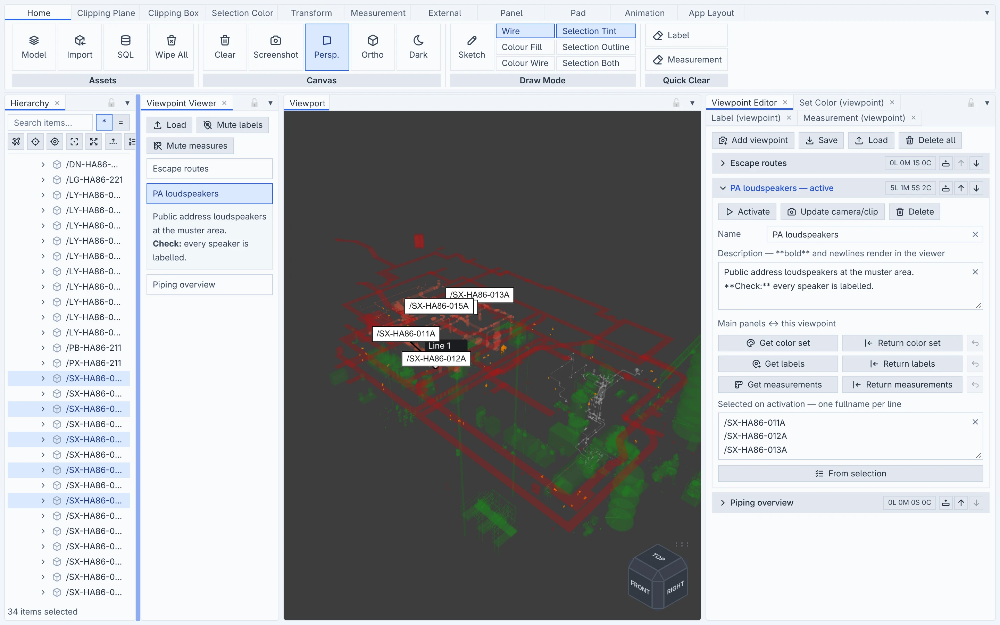

# TreDeSpace Web Viewer

A desktop-style 3D viewer for large plant, CAD and BIM models that runs
entirely in the browser: it converts RVM, IFC, STEP, Navisworks, glTF and
laser-scan files on your machine and renders them with WebGPU.



**[Live demo](https://tredespace.com/docs/demo)** ·
[Product page](https://tredespace.com/docs/) ·
[Host API / iframe SDK](https://tredespace.com/docs/events) ·
[Widget library](https://tredespace.com/docs/widgets)

**Browser:** a recent Chromium-based browser (Chrome, Edge, …) with
WebGPU. For the multi-draw indirect render path, also enable *Unsafe WebGPU*
and *WebGPU Developer Features* in `chrome://flags`.

**Privacy:** files are converted and stored in the browser's own storage,
and the viewer uploads nothing. Only what you allow can read them: a page that
embeds the viewer, or an external app you add under Settings → External, gets
your models and data through the postMessage API — and only from an origin on
the API allowlist (see [EVENTS.md](EVENTS.md), "Origin allowlist").

## About this project

TreDeSpace is made by Vegar Ringdal, with AI-assisted development, and brings
several earlier side projects together into one application. The aim is a
desktop-application feel on the web for CAD/BIM models: the graphics stay
simple — no textures, and flat shading unless a model brings its own normals —
while the tools go deep.

## Supported files

Everything is converted in the browser into the viewer's own format and kept
in the browser's storage.

| File | Extension | What it is | How it is read |
|---|---|---|---|
| RVM | `.rvm` | Plant models from AVEVA PDMS / E3D | Own converter, built on the open-source [rvmparser](https://github.com/cdyk/rvmparser) (MIT) |
| IFC | `.ifc` | Building and infrastructure models, an open standard (buildingSMART) | The open-source [ifc-lite](https://github.com/LTplus-AG/ifc-lite) kernel (MPL-2.0) plus my own merge and cook |
| STEP | `.step`, `.stp` | Mechanical CAD parts and assemblies, an open standard (ISO 10303-21) | Own reader and tessellator |
| GLB | `.glb` | glTF 2.0 binary, an open standard (Khronos) | Own reader; also the "merged" GLB the `rvm2glb` tool writes |
| Navisworks | `.nwd`, `.nwc` | Autodesk Navisworks models — **no public specification** | Own reader, clean-room (see below) |
| Leica LGSX | `.lgsx` | Leica laser-scan projects — **no public specification** | Own reader, clean-room (see below) |
| E57 | `.e57` | Laser scans, an open standard (ASTM E2807) | Own reader |
| TDP / TDPP | `.tdp`, `.tdpp` | The viewer's own cooked model and point-cloud files | No conversion |
| SQLite | `.db`, `.sqlite` and similar | Databases for the SQL panels | sqlite-wasm |

NWD / NWC: geometry and the object tree (names and hierarchy) are imported.
The per-object properties stored in the file are not.

Export: what is on screen can be written as TDP, GLB or IFC.

### How the readers were made — and what I cannot promise

- **Why.** I have mostly moved to Linux on my personal computer, where
  nothing opens NWD, RVM or laser-scan files. I wanted a viewer that runs
  in the browser so I could use the files I had.
- **Clean-room.** The Navisworks and Leica LGSX formats are not published by
  their vendors. Their readers were worked out from the files alone: no
  vendor code, no decompiling or disassembling of any software, and nothing
  is decrypted or any protection circumvented — both formats are read as
  they are stored (NWD is zlib-compressed, not encrypted).
  - *Navisworks:* worked out from the Huldra NWD, FBX and RVM files and
    checked against freely available files found online. Huldra is Equinor's
    open-data plant model: the RVM exports are the source, the NWDs are what
    Navisworks built from them, and the FBX files are Navisworks' own export
    of those NWDs, so the three could be compared. Navisworks itself (the free
    Freedom viewer, on Windows) was used only as a viewer, to see whether a
    converted model looks the same. Everything known is written down in
    [`what_we_know_v1.md`](rust_src/crates/nwd-core/docs/what_we_know_v1.md).
  - *Leica LGSX:* worked out from freely available sample files found online
    and checked against the E57 export of the same projects. No Leica
    software was used. Written down in
    [`LGSX_FORMAT.md`](rust_src/crates/scan-core/docs/LGSX_FORMAT.md).
- **Few test files.** Every converter — the open formats too — was built and
  tested with the limited set of freely available files I could find. Real
  project files vary far more than that.
- **So no guarantee.** A converter may leave parts out, place or colour
  something wrong, or fail on a file, in ways I do not know about yet. I
  cannot promise that an imported model is complete or correct. Compare it
  with its source before relying on it, and report files that go wrong —
  the converters only get better with real-world use.
- **Use at your own risk.** As the [license](#license) says, everything here
  is provided as-is, without warranty.
- **Need full compatibility?** Commercial libraries exist for these formats,
  for example from the Open Design Alliance (ODA). They are most likely
  built with far more resources and test files than this project, and
  probably handle more versions and edge cases. If complete, guaranteed
  support matters for your work, use one of those or the vendor's own
  software.

The sample files in this repository (`convertSamples/`, `samples/`) are test
inputs and demo data. They are not sold; each folder carries the license and
attribution of its files.

## Run it yourself

Needs Node 24+ and npm. The Rust → wasm converters are committed prebuilt, so
Rust is only needed to change them.

```bash
npm install
npm run dev      # Vite dev server — also serves the API demo at /demo/
npm run build    # tsc + vite → dist/
```

Or as a container (rootless nginx serving the build on port 8080):

```bash
docker build -t tredespace .
docker run --rm -p 8080:8080 tredespace     # → http://localhost:8080
```

Per-OS setup, Windows (WSL2), rebuilding the wasm modules, the tests and the
project's conventions are in [CONTRIBUTING.md](CONTRIBUTING.md). **Working on
it with Claude Code?** Read the note on the checked-in settings there first:
they are permissive by design.

## Repository layout

```
src/
  components/   React UI — dialogs + feature panels (the dockable shell lives
                in treDeSpaceUI/dockable/)
  lib/          one folder per domain (messageApi/ = the postMessage host API:
                listener, transport, per-domain handlers) + small flat utils
    render/     renderer.ts (GPU pipeline), shaders/ (WGSL, one module per pass
                family), camera.ts, device.ts, measureSnap.ts (snap classifier)
    overlay/    view/clip gizmos, label + measure overlays
    model/      format.ts (cooked-model parser), pack.ts, GLB/IFC export writers
    math/       m4.ts, quat.ts, project.ts
    opfs/       OPFS file-system helpers
    color/      color names / hex parsing / multi-color rules
    sqlite/     OPFS SQLite VFS + SQL helpers
    modeldb/    model DB worker (hierarchy, selection, export geometry)
    cooker/     GLB → .tdp cooker: worker + prebuilt wasm (merged rvm2glb
                files) + TS cook for standard / instanced glTF
    rvm2glb/    RVM converter — comlink worker + prebuilt wasm
    ifc2glb/    IFC converter — comlink worker + prebuilt wasm
    step2glb/   STEP converter — comlink worker + prebuilt wasm
    nwd2tdp/    Navisworks NWD / NWC converter — comlink worker + prebuilt wasm
    scan2tdpp/  LGSX / E57 laser scan → .tdpp cook — coordinator worker,
                sub-workers + prebuilt wasm
    tdpp/       .tdpp reader, point LOD selection and snapping
  state/        one createStore per domain + *.actions (mutation): viewer,
                assets, stores, labels, measurements, …
  hotkeys/      hotkey bindings (every control gets a hotkey + tooltip)
  treDeSpaceUI/ standalone UI/widget library, packed as an npm tarball
                (@tredespace/ui); must keep compiling on its own (CLAUDE.md)
  generated/    generated files (third-party notices) — do not edit
api/            tredespace-client.ts — copy-paste host SDK (NOT app-bundled)
docs/           product page + generated API reference + live demo → dist/docs/
demo/           postMessage API playground host page → dist/demo/
public/         static assets copied as-is (robots.txt)
samples/        demo assets (Huldra GLB gzipped at build time, license PDF)
rust_src/       Rust workspace: the wasm cooker AND the RVM/IFC/STEP/NWD import
                converters (crates/{rvm,ifc,step,nwd}-{core,cli,wasm},
                rvm-capi, step-capi) →
                src/lib/<unit>/wasm/ — the converters cook straight to .tdp;
                crates/scan-{core,cook,cli,wasm} read LGSX / E57 laser scans
                and cook them to .tdpp (format: crates/scan-cook/docs/)
convertSamples/ sample RVM/IFC/NWD models the converter tests run against
scripts/        generators: gen-api-docs.mjs, gen-widget-docs.mjs,
                gen-third-party-notices.mjs; pack-ui.mjs (npm tarball);
                build-wasm.mjs + wasm-units.mjs (rebuild the Rust wasm modules);
                doc-shots.mjs (user-guide screenshots); checks: boot-test.mjs,
                check-component-size.mjs, anim-e2e.mjs / anim-check.mjs
                (animation end-to-end), parse-test.mts (parse one cooked
                .tdp: node scripts/parse-test.mts <file.tdp>)
plans/          parked, planned and in-progress feature designs
EVENTS.md       postMessage protocol + command catalog
DESIGN.md       architecture / rendering / cooked-format notes
```

## Documentation

- **[DESIGN.md](DESIGN.md)** — architecture, the GPU-driven render pipeline, the
  cooked `.tdp` format, the wasm cooker + import converters, and what is /
  isn't ported from the original native renderer.
- **[EVENTS.md](EVENTS.md)** — the **postMessage host API**: envelope, the
  origin/security allowlist, the full command catalog, and the app → host
  events. The viewer can be embedded in an iframe (or opened as a window) and
  driven by a host page.
- **[api/tredespace-client.ts](api/tredespace-client.ts)** — a dependency-free,
  fully typed SDK you copy into your host app (correlation ids, the ready
  handshake, timeouts and transferables handled; one method per command).
- **Live demo** — served at `/demo/` in dev (and built into `dist/demo/`): it
  embeds the app and drives every command/event with a request/response log.
  `/demo/?dialog=1` is the same page hosted *inside* the viewer — add it as an
  External app under **Settings → External**.
- **[User guide](https://tredespace.com/docs/guide/index.html)**
  (`docs/guide/`) — one page per app layout, with screenshots of the real app.
- **[CONTRIBUTING.md](CONTRIBUTING.md)** — working on the code: setup, the
  Rust → wasm modules and their tests, conventions, screenshots, versioning
  and releases, container images.
- **[CHANGELOG.md](CHANGELOG.md)** — what changed, release by release.

## License

© 2026 Vegar Ringdal.

The viewer started as a side project of mine. When I saw it could be useful
to others, I made it public under a license that lets anyone use it for
free. Companies that own or operate an installation, or do the engineering,
construction and operations work on one, may also open their own deployment
to their project partners. Nobody may offer the viewer to others as a hosted
or managed service. If you improve the viewer itself, the improvement comes
back to everyone; what you build around it stays yours. That is why the
project is split between two licenses:

- **The viewer** — the **TreDeSpace License**: the
  [Elastic License 2.0](https://www.elastic.co/licensing/elastic-license)
  with the additional terms in [`LICENSE`](LICENSE) (the crates declare it as
  `LicenseRef-TreDeSpace`). It covers `src/`, the app itself (except the
  widget library in `src/treDeSpaceUI/`), and `rust_src/`: the Rust cooker,
  the RVM / IFC / STEP / NWD converters and the LGSX / E57 laser-scan cook,
  with their CLIs, the RVM / STEP C APIs and the prebuilt wasm under
  `src/lib/`. The rest of the repository — the user guide and other docs,
  `scripts/`, `tests/`, `docker/` and the build setup — is under it too,
  except the MIT parts below and the sample models in `convertSamples/` and
  `samples/`, which are third-party data under the terms in each folder.
- **The host SDK** ([`api/tredespace-client.ts`](api/tredespace-client.ts)) —
  **MIT**. One copy-paste file your own web app uses to embed the viewer and
  drive it over postMessage; it is not bundled into the app.
- **The widget library** (`src/treDeSpaceUI/`) — **MIT**. The React widgets
  and dockable panel shell the viewer is built with, for your own panels and
  apps. It is packed as an npm tarball (`@tredespace/ui`, not published to
  the npm registry), offered for download from the widget gallery
  (`/docs/widgets.html`); depend on it via `"@tredespace/ui": "file:…"`.
- **The examples** — **MIT**. Code made to be copied into your own apps: the
  API playground (`demo/`), the widget gallery (`docs/gallery/`,
  `docs/widgets.*`) and the live demo page (`docs/demo.html`,
  `docs/demo.ts`), with the theme toggle they share (`docs/theme.ts`).

The MIT parts are the ones that go into your own apps and business
logic: use them however you like, keep the MIT notice, and nothing you write
with them has to be shared.

### The viewer's license in short

You may:

- **use, copy, change and redistribute the viewer**, with no license fee,
  on your own machines, servers or cloud;
- **give your project partners access** — clients, contractors, vendors — to
  your own deployment, for projects you take part in, when you own or
  operate the facility or asset the project is about, or do substantial work
  on the project yourself (engineering, construction, operations) and giving
  access to the viewer is not that work;
- **let your contractors, such as your IT supplier, set up and run your
  deployment** for you, on servers or cloud accounts you control.

You must:

- **share improvements to the viewer.** If you change its code (the
  renderer, a file reader, a converter, anything under the TreDeSpace
  License) and use or distribute the changed version, publish your changes
  and offer them back as a pull request to the
  [source repository](https://github.com/vegarringdal/TreDeSpaceSource)
  within a reasonable time. What you build into the viewer counts as a
  change; what you build around it, or supply to it as an iframe, stays
  yours. I decide whether to merge; by submitting, you let me use, change
  and relicense your changes.
- **keep the attribution.** The About dialog, with "TreDeSpace Web Viewer"
  and "Made by Vegar Ringdal", stays in every copy and changed version,
  working and easy to find. You may add your own branding next to it.

You may not:

- offer the viewer, or access to it, to others as a hosted or managed
  service, paid or free;
- use the "TreDeSpace" name or logo beyond that attribution.

This is a summary; [`LICENSE`](LICENSE) is the binding text.

Everything is provided as-is, without warranty of any kind — use at your own
risk. How the file readers were made, and what that means for what they can
promise, is under [Supported files](#supported-files).

Third-party packages keep their own licenses — the vendored forks
`rust_src/crates/meshopt` and `rust_src/crates/tess2-rust` included. Only
dependencies whose licenses permit use in a proprietary product are included;
their notices are bundled and viewable in the app under
**Settings → About → Show third-party notices** (generated from the shipped
dependency tree by `scripts/gen-third-party-notices.mjs` into
`src/generated/third-party-notices.json`).
